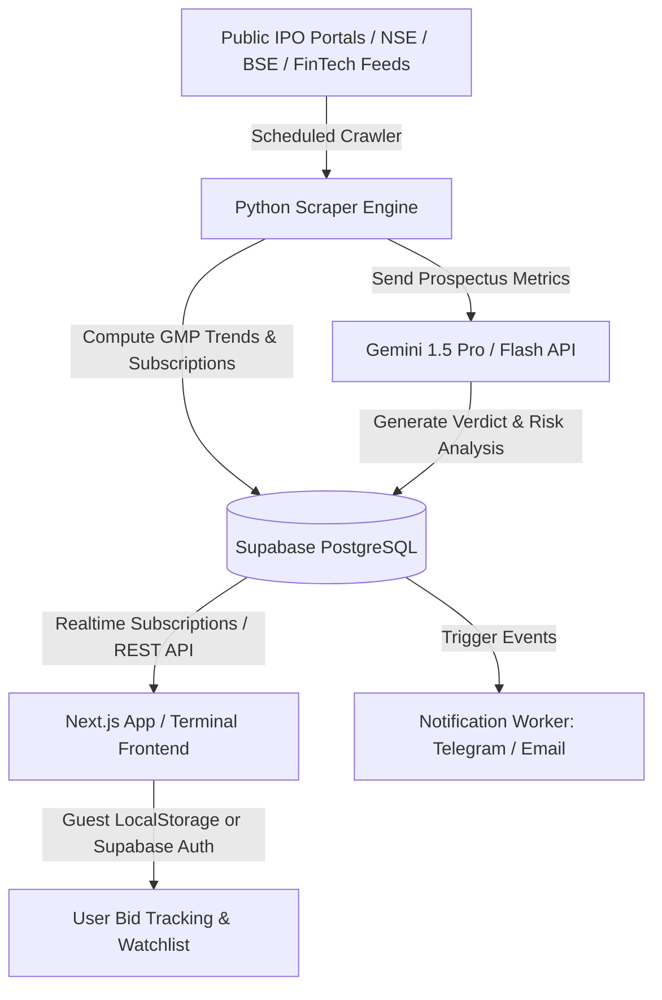

# IPObud — Architecture & Technical Specification

> **Your smart companion for tracking, analyzing, and staying ahead of IPOs (Initial Public Offerings).**

---

## 1. Executive Summary & Vision

**IPObud** is an intelligent, real-time analytics terminal tailored for retail and institutional investors participating in Indian stock market IPOs (NSE & BSE Mainboard & SME). It eliminates the friction of navigating fragmented registrar sites, scattered GMP forums, and opaque 400-page DRHP prospectus documents by unifying:

1. **Live Calendar & Timelines:** Open, upcoming, closed, and listing schedules with countdown timers and lot sizes.
2. **Grey Market Premium (GMP) Intelligence:** Dynamic real-time GMP tracking, estimated listing price, percentage gains, and trend charts.
3. **Live Subscription Tracking:** Real-time demand breakdown across QIB, NII (sNII & bNII), and Retail quotas.
4. **Gemini AI Prospectus Synthesizer:** Instant 1-click synthesis of RHP/DRHP filings, valuation P/E multiples vs peers, financial health (CAGR, EBITDA margins, debt-to-equity), key red flags, and an objective **Apply / Avoid / Listing Gain Only** verdict.
5. **Universal Allotment Status Checker:** Fast lookup across Link Intime, KFintech, Bigshare, and Skyline with PAN / Application number.
6. **Smart Bid Tracker & Alerts:** Hybrid guest-first tracking + optional cloud sync for applied bids, mandate status, and WhatsApp/Telegram/Email notifications.

---

## 2. Monorepo Architecture

```
myGithub/IPObud/
├── apps/
│   └── web/                   # Next.js 14+ App Router, React, Tailwind CSS, Lucide, Recharts
│       ├── public/            # Static assets, branding, broker logos
│       ├── src/
│       │   ├── app/           # Routes: /, /ipo/[slug], /allotment, /gmp-tracker, /watchlist
│       │   ├── components/    # Glassmorphic UI components, IPO cards, Sparklines, AI modal
│       │   ├── lib/           # Supabase client, Gemini API client, utils, formatters
│       │   └── types/         # TypeScript interfaces for IPOs, GMP, and Subscriptions
│       ├── package.json
│       └── tailwind.config.ts
├── services/
│   └── scraper/               # Python 3.11+ crawler & data pipeline
│       ├── crawlers/          # Scrapers for NSE/BSE feeds, Chittorgarh, InvestorGain
│       ├── ai_analyzer/       # Gemini AI RHP parser and rating generator
│       ├── config.py          # Crawler intervals and Supabase connection
│       ├── main.py            # Entry point / scheduled crawler orchestrator
│       └── requirements.txt
├── supabase/
│   ├── migrations/            # SQL schemas, RLS policies, trigger functions
│   │   └── 001_initial_schema.sql
│   └── seed.sql               # Seed data for immediate local dev & demo
├── ARCHITECTURE.md            # This specification
└── README.md                  # Project overview and quickstart
```

---

## 3. Data Flow & System Design



---

## 4. Database Schema (Supabase / PostgreSQL)

### 4.1 Tables:
1. `ipos`:
   - `id`: UUID (Primary Key)
   - `slug`: Text (Unique, e.g., `swiggy-limited`)
   - `company_name`: Text
   - `symbol`: Text (NSE/BSE ticker if assigned)
   - `market_type`: Enum (`MAINBOARD`, `SME`)
   - `price_band_low`: Decimal
   - `price_band_high`: Decimal
   - `lot_size`: Integer
   - `issue_size_cr`: Decimal
   - `fresh_issue_cr`: Decimal
   - `ofs_cr`: Decimal
   - `open_date`: Timestamp
   - `close_date`: Timestamp
   - `allotment_date`: Timestamp
   - `refunds_date`: Timestamp
   - `credit_demat_date`: Timestamp
   - `listing_date`: Timestamp
   - `listing_at`: Array (`NSE`, `BSE`)
   - `registrar_name`: Text
   - `registrar_url`: Text
   - `status`: Enum (`UPCOMING`, `ACTIVE`, `CLOSED`, `LISTED`)
   - `drhp_url`: Text
   - `rhp_url`: Text

2. `gmp_history`:
   - `id`: UUID (Primary Key)
   - `ipo_id`: Foreign Key (`ipos.id`)
   - `gmp_value`: Decimal (₹)
   - `estimated_listing_price`: Decimal (₹)
   - `gain_percentage`: Decimal (%)
   - `recorded_at`: Timestamp
   - `source`: Text

3. `subscription_snapshots`:
   - `id`: UUID (Primary Key)
   - `ipo_id`: Foreign Key (`ipos.id`)
   - `qib_multiple`: Decimal
   - `nii_multiple`: Decimal
   - `b_nii_multiple`: Decimal
   - `s_nii_multiple`: Decimal
   - `retail_multiple`: Decimal
   - `total_multiple`: Decimal
   - `day_number`: Integer (Day 1, 2, 3)
   - `snapshot_at`: Timestamp

4. `ai_analyses`:
   - `id`: UUID (Primary Key)
   - `ipo_id`: Foreign Key (`ipos.id`, Unique)
   - `verdict`: Enum (`STRONG_APPLY`, `APPLY`, `LISTING_GAINS_ONLY`, `AVOID`, `HIGH_RISK`)
   - `risk_score`: Integer (1-100)
   - `pe_ratio`: Decimal
   - `industry_pe`: Decimal
   - `strengths`: JSONB Array
   - `risks`: JSONB Array
   - `financial_summary`: JSONB (Revenue CAGR, PAT, Debt/Equity)
   - `generated_at`: Timestamp

5. `user_bids` (Hybrid - Supabase / Local):
   - `id`: UUID
   - `user_id`: UUID (Supabase Auth, nullable for guests)
   - `ipo_id`: Foreign Key (`ipos.id`)
   - `category`: Enum (`RETAIL`, `HNI_SMALL`, `HNI_BIG`, `SHAREHOLDER`)
   - `lots_applied`: Integer
   - `bid_price`: Decimal
   - `application_no`: Text
   - `pan_masked`: Text (e.g. `ABCDE****F`)
   - `allotment_status`: Enum (`PENDING`, `ALLOTTED`, `NOT_ALLOTTED`)
   - `lots_allotted`: Integer

---

## 5. UI/UX Design System: High-Tech Financial Terminal

- **Color Palette:**
  - Background: Deep Obsidian Slate (`#0B0F19`, `#111827`)
  - Glass Card: `rgba(17, 24, 39, 0.75)` with `backdrop-blur-xl` and border `rgba(255, 255, 255, 0.08)`
  - Primary Neon Gains: Emerald Green (`#10B981`, `#059669`)
  - Electric Tech Accent: Cyan / Sky (`#06B6D4`, `#38BDF8`)
  - Warning / Risky Accent: Amber (`#F59E0B`)
  - Negative / Bearish: Coral Rose (`#F43F5E`)
- **Visual Features:**
  - Real-time animated ticker ribbon with latest GMP gain spikes
  - Interactive mini sparklines for GMP momentum over past 7 days
  - Instant Allotment Search modal with 1-click registrar deep-linking
  - Gemini AI "Intelligence Breakdown" drawer with interactive pros/cons and valuation comparison chart

---

## 6. Implementation Milestones

- **Phase 1: Project Scaffolding & Database Foundation (Current)**
  - Monorepo folder setup: `apps/web`, `services/scraper`, `supabase/`
  - SQL Schema migration & Seed data containing live Mainboard & SME IPOs
  - Web client setup with terminal UI components and mock data fallbacks
- **Phase 2: Core Terminal Dashboard & Live Trackers**
  - Interactive IPO grid & table (filtering by Mainboard, SME, Status, GMP % gain)
  - Detailed IPO page with timeline stepper, lot calculator, subscription gauge
  - Fast Allotment Status checker
- **Phase 3: Python Ingestion Scraper & Gemini AI Engine**
  - Crawler pipeline for automated GMP & Subscription updates
  - Gemini AI RHP analyzer generating real-time verdict, pros/cons & risk metrics
- **Phase 4: Personalization, Bids Tracker & Realtime Alerts**
  - Bid manager with expected P&L on listing day
  - Alert integrations (Telegram bot, Email)
